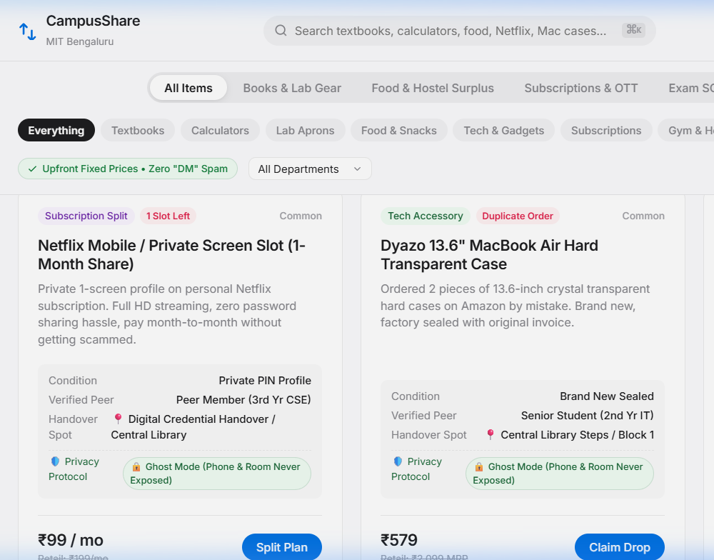
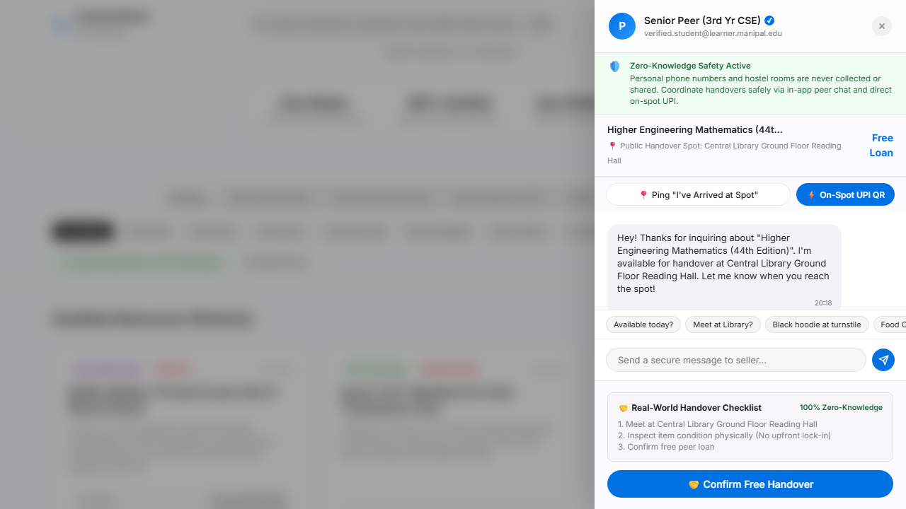
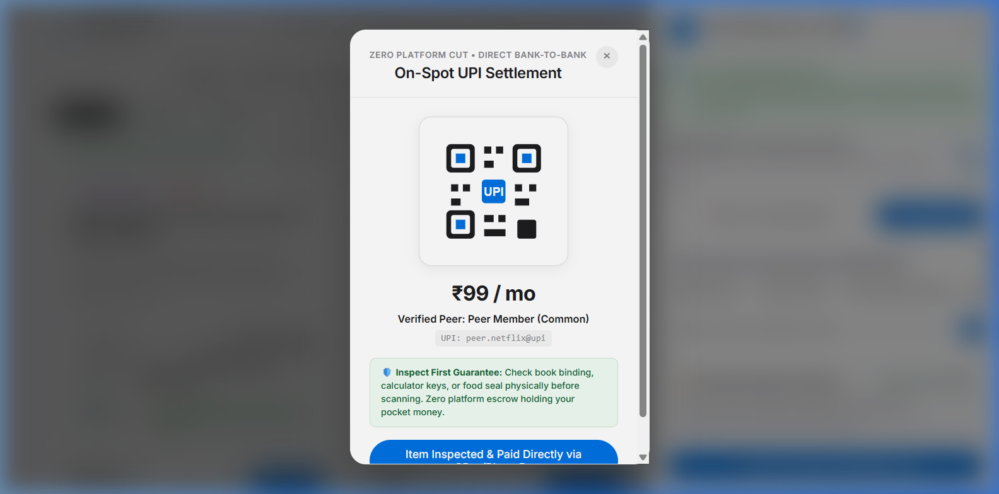
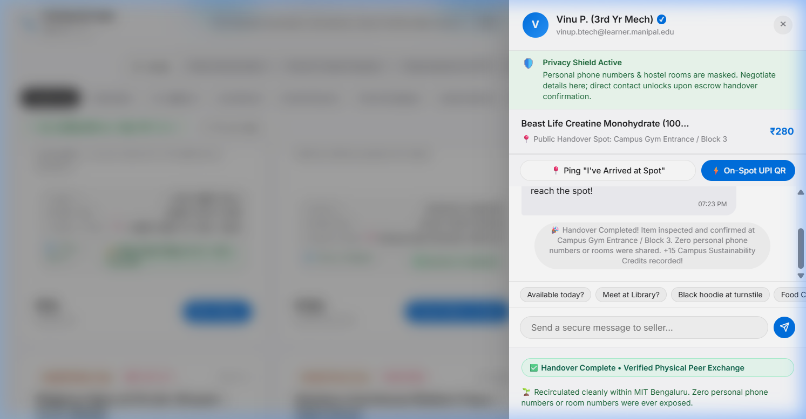

# CampusShare 🎒🔄

> **A circular economy for campus life: Verified peer-to-peer textbook, equipment, and resource exchange platform.**

[](https://capsid85.github.io/CampusShare/)
[](#-tech-stack)
[](https://manipal.edu/mitblr.html)
[](LICENSE)

---

## 🌐 Live Web Application

- **Live Hosted Application:** [https://capsid85.github.io/CampusShare/](https://capsid85.github.io/CampusShare/)  
*(Fully interactive — open on desktop or mobile without any setup)*

---

## 💡 About CampusShare

College students spend thousands of rupees each semester purchasing specialized supplies—such as advanced engineering mathematics textbooks, scientific calculators, chemistry lab coats, and engineering drafters. Once final examinations conclude, these expensive supplies sit idle in hostel rooms.

Meanwhile, informal campus chat channels (WhatsApp and Telegram groups) fail:
- **Buried Messages**: Listings get buried under hundreds of chat messages in minutes.
- **"DM for Price" Games**: Lack of transparent pricing leads to awkward haggling and delays.
- **Privacy Concerns**: Female students and hostel residents hesitate to share personal phone numbers or room numbers on public groups.
- **Payment Risks**: Students risk losing pocket money to unverified advance online transfers before seeing the item.

**CampusShare** solves this with a verified, hyper-local circular platform engineered around verified student credentials (`@learner.manipal.edu`), transparent fixed pricing, zero platform commission, and zero-knowledge privacy.

---

## ✨ Key Features

### 🚨 Express Exam & Lab SOS (1-Day / Single-Use)
Designed for last-minute emergencies: when a student's calculator dies 30 minutes before an end-semester exam or when they forget their lab coat for a practical viva. Instead of spending ₹1,500 on a new tool, students can claim a ₹20 emergency slot and pick it up outside the exam hall or lab block in under 5 minutes.

### ⚡ Flash Drops (Hostel & Food Surplus)
Real-time listings with live countdown timers for midnight hostel food surplus, sealed pantry food, and accidental duplicate online orders (e.g., duplicate laptop sleeves). Fixed transparent pricing prevents awkward bargaining and eliminates campus waste.

### 🎟️ Subscriptions & Digital Splits
Enables verified campus peers to safely share private profile slots on personal family plans (Netflix, Spotify, study subscriptions). Verification through university credentials eliminates account theft and advance payment fraud.

### 📚 Borrow for Free & Low-Cost Renting
Full-semester free textbook lending between seniors and freshers, as well as low-cost short rentals (₹30–₹40/week) during exam fortnights.

### 🛡️ Zero-Knowledge Ghost Privacy Protocol
Public listings **never** expose personal phone numbers or hostel room numbers. Items are anchored strictly to designated public campus landmarks (Central Library, Food Court, Academic Blocks).

### 💸 Direct On-Spot UPI Settlement
Zero platform commission and zero escrow holding student money. The buyer physically inspects the book or instrument at the campus landmark first, scans the seller's direct UPI QR code (GPay/PhonePe), and both confirm completion on-spot.

### 📍 Arrival Beacon Ping
A one-click notification inside the slide-over chat (`"I've arrived at Central Library wearing a black hoodie"`) that eliminates physical handover confusion.

---

## 🖥️ User Interface Preview

| Platform Feed & Filters | Slide-Over Chat & Meeting Beacon |
|---|---|
|  |  |

| Direct On-Spot UPI Settlement | Handover Confirmation |
|---|---|
|  |  |

---

## 🚀 Getting Started Locally

No complex dependencies, build tools, or package managers required. The entire application runs natively in any modern browser.

### 1. Clone the repository
```bash
git clone https://github.com/capsid85/CampusShare.git
cd CampusShare
```

### 2. Run locally
You can simply double-click `index.html` (or `prototype/index.html`) to open it directly in your browser.

Or launch with a lightweight local web server:
```bash
# Using Python 3
python -m http.server 8000
```
Then visit `http://localhost:8000` in your web browser.

---

## 🏗️ Tech Stack & Architecture

- **Semantic Markup**: HTML5 with ARIA accessibility roles and segmented control components.
- **Styling**: Vanilla CSS3 featuring custom properties, glassmorphism (`backdrop-filter`), Apple Keynote-inspired typography, and responsive grid/flexbox layouts.
- **Application Logic**: Vanilla JavaScript (ES6+) with zero external runtime dependencies.
  - Client-side category and keyword search filtering (`⌘K`).
  - Modal workflows (Item Listing, On-Spot UPI QR Code generation).
  - Apple-style slide-over chat drawer with simulated peer interaction.
  - Dynamic countdown timers for flash drops.

---

## 📂 Repository Structure

```
CampusShare/
├── .gitignore               # Excludes OS artifacts & local files
├── index.html               # Root entry point with instant redirect to application
├── LICENSE                  # MIT Open Source License
├── README.md                # Project documentation
│
├── prototype/               # Web Application Source
│   ├── index.html           # Main application structure
│   ├── style.css            # Design system, glassmorphism & responsive styles
│   ├── app.js               # Search, filters, modals, and interaction logic
│   ├── screenshot.png       # UI preview asset
│   └── screenshot_flash.png # Flash drop preview asset
│
└── [Screenshots & Assets]   # Documentation preview assets
    ├── clean_cards_two_col.png
    ├── clean_chat_drawer.png
    ├── clean_prototype_cards.png
    ├── clean_upi_modal.png
    └── handover_completed.png
```

---

## 📄 License

This project is licensed under the [MIT License](LICENSE).
