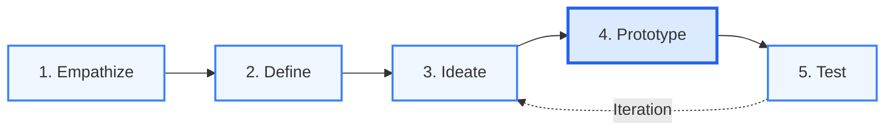

# CampusShare 🎒🔄

> **A Circular Economy for Campus Life: Verified Peer-to-Peer Academic Resource & Book Exchange Platform**  
> *Developed for Design Thinking (HUM_4342) • Manipal Institute of Technology (MIT) Bengaluru, MAHE*

[](https://capsid85.github.io/CampusShare/)
[](https://manipal.edu/mitblr.html)
[-ea580c.svg?style=flat-square)](https://manipal.edu/mitblr.html)
[](#contributors--mentorship)
[](#-repository-structure)
[](LICENSE)

---

## 📖 Table of Contents

- [Project Overview](#-project-overview)
- [Design Thinking Methodology](#-design-thinking-methodology)
  - [Phase 1: Empathize & Field Research](#phase-1-empathize--field-research)
  - [Phase 2: Define & 5-Whys Analysis](#phase-2-define--5-whys-root-cause-analysis)
  - [Phase 3: Ideate & Solve](#phase-3-ideate--solve)
  - [Phase 4: Prototype](#phase-4-prototype)
  - [Phase 5: Test & Validate](#phase-5-test--validate)
- [Core Platform Innovations](#-core-platform-innovations)
- [Live Interactive Prototype](#-live-interactive-prototype)
- [Repository Structure](#-repository-structure)
- [Automated Python Generators](#-automated-python-generators)
- [Video Presentation & Script](#-video-presentation--script)
- [Team Finishing & Submission Guide](#-team-finishing--submission-guide)
- [Contributors & Mentorship](#-contributors--mentorship)

---

## 🌟 Project Overview

Undergraduate engineering students at **MIT Bengaluru** spend thousands of rupees each semester on specialized academic equipment—such as *B.S. Grewal's Higher Engineering Mathematics*, *Casio fx-991 scientific calculators*, *chemistry lab coats*, and *mini drafters*. Ironically, once semester examinations finish, these expensive resources sit neglected in hostel cupboards.

Meanwhile, informal campus communication channels (unorganized WhatsApp and Telegram groups) fail:
1. **Buried Notices**: Listings get lost under hundreds of daily spam messages within 15 minutes.
2. **"DM for Price" Games**: Lack of transparent pricing leads to awkward haggling and delays.
3. **Privacy Risks**: Female students are hesitant to publicize personal WhatsApp numbers or hostel room numbers on open group chats.
4. **Advance Payment Scams**: Students risk losing pocket money to unverified UPI transfers prior to physical inspection.

**CampusShare** resolves this disconnect with a verified, hyper-local circular exchange platform engineered specifically around campus geography, verified student identities (`@learner.manipal.edu`), zero platform commission, and zero-knowledge privacy.

---

## 🧠 Design Thinking Methodology



### Phase 1: Empathize & Field Research
- **Qualitative Observational Research**: Audited real MIT Bengaluru student WhatsApp batch channels, campus buy/sell threads, and hostel common areas.
- **Key Survey Data**:
  - **88%** of 1st-year students spend ₹2,500–₹4,500 every semester on specialized gear needed for only 16 weeks.
  - **92%** of senior students have 3+ textbooks and tools sitting locked in hostel cupboards.
  - Accidental duplicate orders (e.g., MacBook cases from Amazon), sealed pantry snacks, and split digital subscriptions (Netflix/Spotify) are frequently traded informally without structure.
- **Identified User Pain Points**:
  - Financial drain on freshers with every new syllabus.
  - Cluttered, informal social channels with zero search or category filtering.
  - Security and privacy concerns regarding personal phone number exposure.

### Phase 2: Define & 5-Whys Root Cause Analysis
**Official Problem Statement:**
> *"Undergraduate engineering students at MIT Bengaluru incur substantial recurring financial burdens each semester purchasing temporary academic resources that are abandoned after single-term use, because informal campus communication channels lack verification, itemized search, and structured peer-to-peer lending models—leaving senior student inventory unutilized."*

#### The 5-Whys Analysis
1. **Why do freshers overspend on tools?**  
   Because they purchase brand-new copies from commercial external retail shops.
2. **Why don't they acquire them from seniors?**  
   Because seniors leave them locked away in hostel rooms after their exams.
3. **Why don't seniors sell or lend them?**  
   Because posting on general WhatsApp groups is unorganized and tedious.
4. **Why are WhatsApp groups ineffective?**  
   Because chat groups lack search indexing, standardized categories, upfront pricing tags, and availability status.
5. **Root Cause:**  
   **There is no dedicated, campus-exclusive web portal tailored for student resource lending and physical handover at campus landmarks.**

**How Might We (HMW) Question:**
> *"How might we connect junior and senior students for safe, verified, zero-commission exchange of academic resources at designated campus landmarks?"*

### Phase 3: Ideate & Solve
To eliminate friction, we formulated a multi-tier exchange model:
- **Borrow for Free**: Full-semester lending for foundational textbooks.
- **Rent at Nominal Cost**: Short-term rentals (₹30–₹40/week) during mid-term and end-term exam periods.
- **Buy at 75% Discount**: Permanent asset transfer from graduating seniors.
- **🚨 Exam & Lab SOS**: Emergency 1-day or 3-hour micro-borrowing (₹20) for last-minute exam hall emergencies.
- **⚡ Flash Drops**: Fixed-price transfers for midnight hostel food surplus and surplus goods to achieve zero campus waste.
- **🎟️ Digital Splits**: Safe sharing of private profiles on verified campus accounts (Netflix, Spotify, Chegg).

### Phase 4: Prototype
We engineered a high-fidelity, Apple-grade web application with responsive glassmorphism, instant search filtering, real-time slide-over negotiation drawer, landmark handover coordination, and direct on-spot UPI QR settlement.

### Phase 5: Test & Validate
Conducted prototype walkthroughs and user testing with MIT Bengaluru batchmates across engineering cycles:
- **Zero-Knowledge Privacy Verified**: Female students validated that eliminating personal contact numbers and room numbers from public listings made them comfortable listing unused items.
- **On-Spot Trust Verified**: Students praised the physical-inspection-first flow before scanning a seller's direct GPay/PhonePe QR code.
- **No More "DM for Price"**: 100% upfront pricing removed awkward haggling friction.
- **Landmark Safety**: Pre-designated campus meetup spots (Central Library, Food Court, Academic Block 1) ensured safe physical meetings.

---

## ⚡ Core Platform Innovations

| Feature | Description | Real-World Impact |
|---|---|---|
| **🚨 Exam & Lab SOS** | Instant 1-day/3-hour rental for ₹20 outside exam hall gates or lab corridors. | Prevents students from failing vīvas or spending ₹1,500 on an emergency calculator 30 minutes before exams. |
| **⚡ Flash Drops** | Real-time surplus listings (midnight food, unopened pantry snacks, surplus dorm items) with countdown timers. | Eliminates campus food waste and enables instant student re-sale. |
| **🎟️ Digital Splits** | Coordinated profile slots for personal Netflix or Spotify Family plans at verified student pricing. | Eliminates advance payment fraud and account theft via `@learner.manipal.edu` verification. |
| **🛡️ Ghost Privacy Protocol** | Public listings never display student phone numbers or room numbers. | 100% spam prevention; complete safety for students living in campus hostels. |
| **💸 Direct On-Spot UPI** | Buyer physically inspects item at the campus landmark, then scans seller's direct UPI QR code. | Zero platform escrow fees, zero commission, and zero advance payment scams. |
| **📍 Arrival Beacon Ping** | One-click ping (`"I've arrived at Central Library wearing a black hoodie"`) inside chat. | Zero physical handover friction or wandering around campus landmarks. |

---

## 💻 Live Interactive Prototype

The prototype is built with clean HTML5, modern CSS3 (with glassmorphism and Apple Keynote aesthetics), and vanilla JavaScript. It requires no heavy dependencies or build tools.

### 🌐 Live Hosted Prototype
- **Live URL**: [https://capsid85.github.io/CampusShare/](https://capsid85.github.io/CampusShare/) *(Zero setup needed — click to explore on desktop or mobile)*

### Running Locally
1. Clone this repository:
   ```bash
   git clone https://github.com/capsid85/CampusShare.git
   cd CampusShare
   ```
2. Simply double-click `prototype/index.html` or the root `index.html` to open in any web browser.
3. Alternatively, launch a lightweight local server:
   ```bash
   python -m http.server 8000
   ```
   Then open `http://localhost:8000` in your browser.

### Key Interactive Features to Explore
- **Segmented Filter Switcher**: Click through *All Items*, *Books & Lab Gear*, *Food & Hostel Surplus*, *Subscriptions & OTT*, *Exam SOS (1-Day)*, and *Free to Borrow*.
- **Search Dock (`⌘K`)**: Type any keyword (e.g., `calculator`, `paratha`, `netflix`, `grewal`, `case`) to test instant filtering.
- **Slide-over Chat Drawer**: Click `"Chat & Meet at Spot"` on any card to open the negotiation drawer with pre-built message chips.
- **Arrival Beacon**: Click `"📍 Ping Arrival at Spot"` inside the chat drawer to trigger a simulated arrival cue.
- **On-Spot UPI QR Modal**: Click `"⚡ On-Spot UPI QR"` to simulate inspecting the item and scanning the seller's direct payment QR code.
- **List Item Modal**: Click `"+ List Item"` in the navigation bar to preview how seniors post gear with automatic Zero-Knowledge Ghost Privacy enabled.

---

## 📂 Repository Structure

```
CampusShare/
├── .gitignore                               # Clean exclusion of Office lock files & python cache
├── index.html                               # Root entry point with instant redirect to prototype
├── requirements.txt                         # Python dependencies (python-docx, python-pptx)
├── LICENSE                                  # MIT Open Source License
├── README.md                                # Comprehensive project documentation
├── TEAM_COLLABORATION_GUIDE.md              # Step-by-step checklist for teammates to finalize submission
├── VIDEO_SCRIPT_AND_GUIDE.md                # 4-speaker video presentation script & recording checklist
│
├── prototype/                               # High-Fidelity Web Application
│   ├── index.html                           # Apple-grade semantic web interface
│   ├── style.css                            # Glassmorphism, CSS variables, responsive design
│   ├── app.js                               # Interactive state management, filter & modal logic
│   ├── screenshot.png                       # Primary UI preview
│   └── screenshot_flash.png                 # Flash drop & countdown UI preview
│
├── build_presentation.py                    # Script generating 16:9 widescreen presentation deck
├── build_report.py                          # Script formatting complete academic report document
├── update_poster.py                         # Script generating academic exhibition poster slide
│
├── [Locally Generated via Python Scripts]   # Kept local for privacy & shared via WhatsApp
│   ├── Design Thinking_Presentation_Final.pptx
│   ├── Design Thinking Report.docx
│   └── Design Thinking Poster.pptx
│
└── [Screenshots & UI Assets]               # High-resolution rendered assets for reports & slides
    ├── clean_cards_two_col.png
    ├── clean_chat_drawer.png
    ├── clean_chat_drawer_portrait.png
    ├── clean_prototype_cards.png
    ├── clean_prototype_view.png
    ├── clean_upi_modal.png
    ├── handover_completed.png
    ├── privacy_chat_locked.png
    ├── privacy_chat_unlocked.png
    ├── prototype_screenshot.png
    ├── slide2_rendered.png
    ├── slide3_rendered.png
    ├── slide12_rendered.png
    ├── slide13_rendered.png
    └── upi_qr_modal.png
```

---

## 🛠️ Automated Python Generators

This repository contains standalone Python automation scripts to generate and format the academic presentation deck, report, and poster cleanly:

### 1. Requirements Installation
```bash
pip install -r requirements.txt
```

### 2. Presentation Deck Generator (`build_presentation.py`)
Generates a 15-slide, 16:9 widescreen presentation deck adhering to Apple typography and design guidelines.
```bash
python build_presentation.py
```
*Output: `Design Thinking_Presentation_Final.pptx`*

### 3. Academic Report Generator (`build_report.py`)
Injects structured headings, 5-Whys tables, customer journey maps, prototype specifications, and user testing data into the official departmental Word template.
```bash
python build_report.py
```
*Output: `Design Thinking Report.docx`*

### 4. Project Poster Generator (`update_poster.py`)
Updates the official academic exhibition poster with crisp cards representing each Design Thinking phase.
```bash
python update_poster.py
```
*Output: `Design Thinking Poster.pptx`*

---

## 🎬 Video Presentation & Script

A complete word-for-word presentation script is prepared in [`VIDEO_SCRIPT_AND_GUIDE.md`](VIDEO_SCRIPT_AND_GUIDE.md) tailored for a **5 to 7-minute** team recording:

| Speaker | Phase / Section | Screen to Share | Time |
|---|---|---|---|
| **Member 1 (Sridhar)** | **Part 1:** Welcome, Academic Context, Empathy Phase, 5-Whys Analysis & Ideation | Slides 1 to 8 (PowerPoint Full-Screen `F11`) | ~2.5 – 3.0 mins |
| **Member 2 (Priyansh Kashyap)** | **Part 2:** Live Interactive Prototype Walkthrough, User Testing Feedback & Conclusion | Live Browser (`prototype/index.html` or GitHub Pages) & Slides 13 to 15 | ~3.0 – 3.5 mins |

*See [`VIDEO_SCRIPT_AND_GUIDE.md`](VIDEO_SCRIPT_AND_GUIDE.md) for recording platform checklist, webcam recommendations, and word-for-word lines.*

---

## 🤝 Team Finishing & Submission Guide

If you are a teammate collaborating on this repository, please review [`TEAM_COLLABORATION_GUIDE.md`](TEAM_COLLABORATION_GUIDE.md) for step-by-step instructions:
1. **Update Student Details**: Fill in your registration number in `build_report.py`, `build_presentation.py`, and `update_poster.py`.
2. **Re-run the Python Scripts**: Regenerate the `.docx` and `.pptx` files with your names.
3. **Record the Video**: Follow the 2-member script in [`VIDEO_SCRIPT_AND_GUIDE.md`](VIDEO_SCRIPT_AND_GUIDE.md) on Zoom/Google Meet.
4. **Export Final Deliverables**: Save final copies of the Report (`.pdf` / `.docx`), Presentation (`.pptx` / `.pdf`), Poster (`.pptx`), and Video URL for submission on the academic portal.

---

## 👨‍🏫 Contributors & Mentorship

- **Faculty Mentor**: **Dr. Vandana Jha**, Associate Professor, MIT Bengaluru (MAHE)
- **Course**: Design Thinking (HUM_4342)
- **Institution**: Manipal Institute of Technology, Bengaluru, Manipal Academy of Higher Education (MAHE)
- **Student Team**:
  - **Sridhar Madhira** — CSE (AI) (Registration No: `235890500`)
  - **Priyansh Kashyap** — CSE (AI) (Registration No: `235890468`)

---
*Developed with deep human empathy for the MIT Bengaluru student community.*
